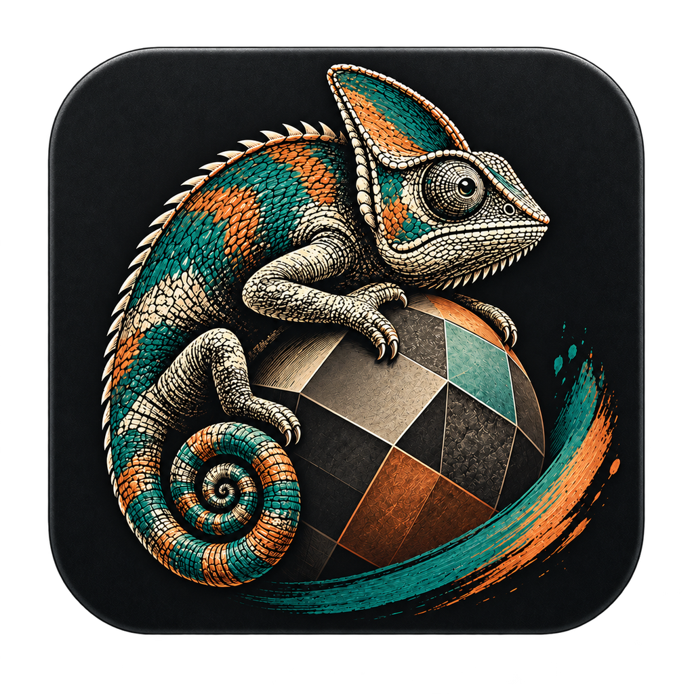

<p align="center">
  
</p>

<h1 align="center">ReEtched</h1>

<p align="center">
  <b>Open-source 3D texture painting.</b><br>
  Paint, bake and texture your models, and bring your Substance Painter projects with you.
</p>

<p align="center">
  <a href="https://github.com/Redactional/ReEtched/releases/latest"></a>
  <a href="https://github.com/Redactional/ReEtched/actions/workflows/ci.yml"></a>
  
  <a href="#license"></a>
</p>

<p align="center">
  <a href="#download">Download</a> ·
  <a href="#features">Features</a> ·
  <a href="https://redactional.github.io/ReLauncher/docs.html?p=reetched">Documentation</a> ·
  <a href="docs/migrating-from-painter.md">Coming from Painter</a> ·
  <a href="https://github.com/Redactional/ReEtched/issues/new/choose">Report a bug</a>
</p>

---

ReEtched is a full texturing app for game and film assets: a layer stack with masks and smart materials, a mesh map baker, procedural materials, a real-time PBR viewport and a GPU path tracer. It looks and works like Substance 3D Painter, keyboard shortcuts included, so you can start right away. It's free, open source and runs on Windows, macOS and Linux.

## Download

**The easy way: [ReLauncher](https://redactional.github.io/ReLauncher/).** It installs ReEtched, keeps it up to date and sets up everything it needs.

Or grab an installer from the [latest release](https://github.com/Redactional/ReEtched/releases/latest):

| System | Download |
|---|---|
| Windows 10 / 11 (64-bit) | Installer (`.exe`) |
| macOS (Apple Silicon) | Disk image (`.dmg`) |
| Linux (x86-64) | `.deb` package or `.AppImage` |

Portable `.zip` builds for each system are on the release page too.

### System requirements

- A GPU with Vulkan, Metal or DirectX 12 support. A dedicated GPU is recommended for 4K texture sets.
- Optional: [Python 3.8 or newer](https://www.python.org/downloads/) for scripts and plugins.

## Features

### Painting
- Paint on the model or in the 2D UV view, with pen pressure, mirror and radial symmetry, lazy mouse and image alphas.
- Tools: **Paint**, **Eraser**, **Projection**, **Polygon Fill** (triangles, polygons, UV islands or the whole mesh), **Smudge**, **Clone** and **Path**.
- UDIM tiles.

### Layers and materials
- A Painter-style layer stack: paint and fill layers, folders, every blend mode, and blending and opacity per channel.
- Masks painted by hand, from images, or generated from the mesh maps: edge wear, cavity, ambient occlusion, gradients, thickness, noise, Levels and ID color selection.
- **Smart materials** and smart masks: built-ins, or save your own and reuse them across projects.
- **Procedural materials** with editable parameters, and **Substance Designer `.sbs` graphs** used directly as fills, no Adobe software needed.
- Fill projections: UV, tri-planar, planar, spherical and cylindrical.

### Baking
- Normal (high to low poly, with cage), world-space normal, ID, ambient occlusion, curvature, position, thickness, height and opacity, with antialiasing and dilation.
- Or import maps you baked elsewhere.

### Viewport and rendering
- Real-time PBR with HDR image-based lighting, parallax from height, bloom and ACES, AgX or Khronos Neutral tone mapping.
- Shading models: metal/rough, Adobe Standard Material and OpenPBR, plus your own Painter `.glsl` shaders.
- OpenColorIO color management with the ACES 1.x and 2.x configs built in.
- A GPU **path tracer** for final-quality previews.

### Import and export
- Meshes: FBX, OBJ, glTF/GLB and USD. Each material becomes a texture set. Swap in an updated mesh and keep your paint.
- Texture export presets for Unreal, Unity, glTF, Blender and Godot, with channel packing, padding and PNG, TGA, TIFF or EXR output. Painter `.spexp` presets work too.
- Layered **PSD export**, and mesh export as USD or OBJ with textures.

### Substance Painter projects
- **Open `.spp` files without Painter installed.** ReEtched converts them into its own projects (the original is never changed) with texture sets, the layer stack, fills, masks and baked maps. Paint is rebuilt from Painter's stored strokes.
- Painter's own final result comes along as a top layer, so the project looks right immediately.
- See [Coming from Painter](docs/migrating-from-painter.md) for what converts and what's different.

### Workflow
- Python scripting: a console, scripts and plugins with their own menu entries ([API guide](crates/reetched-script/README.md)).
- An asset library over your own folders, with search, tags, favorites and thumbnails.
- Project templates, autosave and crash recovery.
- Painter or Blender keymaps with every shortcut rebindable, and an adjustable interface size.

## Getting started

1. **File → New project** (or <kbd>Ctrl</kbd>+<kbd>N</kbd>): pick a mesh and a template.
2. **Bake** the mesh maps under *Texture Set Settings → Mesh maps* so generators and smart materials can follow the shape.
3. **Paint** with <kbd>1</kbd>, or drag a material from the Assets panel onto the model.
4. **File → Export textures** (<kbd>Ctrl</kbd>+<kbd>Shift</kbd>+<kbd>E</kbd>) with the preset for your engine.

Navigation: <kbd>Alt</kbd>+left drag orbits, middle drag pans, <kbd>Alt</kbd>+right drag or the wheel zooms, <kbd>F</kbd> frames the model.

## Building from source

You need [Rust](https://rustup.rs) 1.96 or newer and a C compiler (Visual Studio Build Tools on Windows, `xcode-select --install` on macOS, `gcc` or `clang` on Linux).

```bash
cargo run --release -p reetched-app
```

See [CONTRIBUTING.md](CONTRIBUTING.md) for the project layout, tests and how releases are made.

## Contributing

Bug reports, ideas and pull requests are welcome.

- **Found a bug or have an idea?** [Open an issue](https://github.com/Redactional/ReEtched/issues/new/choose). The forms ask for what's needed to act on it.
- **Want to contribute code?** Read [CONTRIBUTING.md](CONTRIBUTING.md) first, especially the rules about Adobe files and code.

## License

ReEtched is dual-licensed under [MIT](LICENSE-MIT) or [Apache 2.0](LICENSE-APACHE), at your option.

ReEtched is not affiliated with or endorsed by Adobe. Adobe and Substance are trademarks of Adobe Inc.
